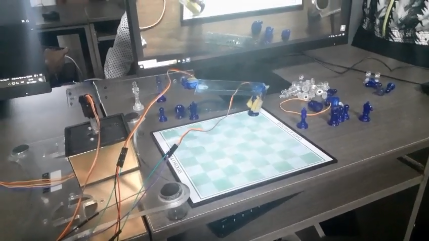

# Motor básico de ajedrez + controlador de brazo robot Arduino
Motor básico de ajedrez que se comunica con una placa Arduino para controlar un brazo robot

# Video de demostración (grabado en 2023)

